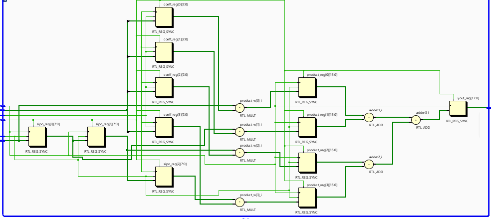
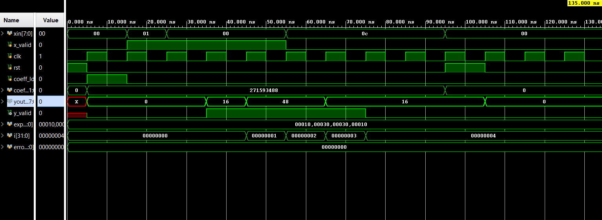
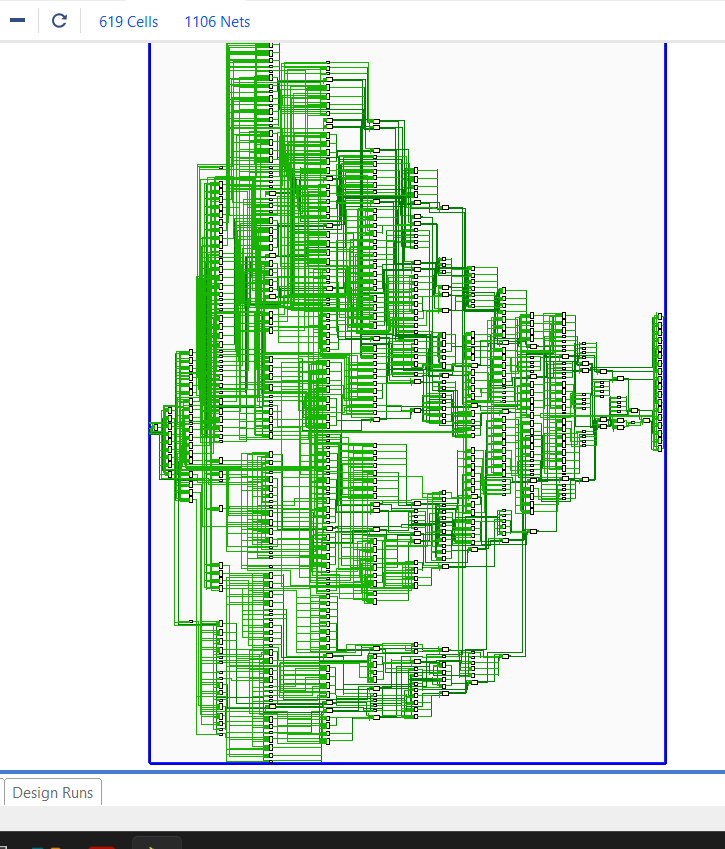

# 4-Tap Pipelined Direct Form FIR Filter

A programmable 4-tap Direct Form FIR filter in Verilog, designed with ASIC implementation in mind. It has a fixed 2-cycle latency and an atomic parallel-load coefficient bank.

> **Status: work in progress.** The RTL, specification, and a first self-checking testbench (impulse response) are done and passing. More tests, timing closure, and a block diagram are still to come. See [Status](#status).

Full details are in the [specification](docs/SPEC.md).

## Features

- Direct Form architecture, 4 taps
- Signed 8-bit input samples and coefficients
- 16-bit products and an 18-bit signed output (overflow is not possible)
- Fixed 2-cycle latency from `x_valid` to `y_valid`
- Stall ("bubble") support: when `x_valid = 0`, the sample history freezes
- All four coefficients load in parallel on a single clock edge
- Synchronous, active-high reset
- Datapath and control are separate modules

## Architecture

Samples enter a serial-in, parallel-out (SIPO) history buffer. Each tap multiplies its sample by its coefficient, and a two-layer adder tree sums the products:

`y[n] = h0*x[n] + h1*x[n-1] + h2*x[n-2] + h3*x[n-3]`

**Pipeline**

- **Edge 1:** the four products are latched, the SIPO shifts, and `x_valid` enters the valid pipeline.
- **Edge 2:** the adder tree output is latched into `yout`, and `y_valid` goes high.

Elaborated schematic of the datapath (`fir_d`) from Vivado: coefficient and SIPO registers, four multipliers, product registers, and a two-level adder tree feeding the output register.



## Modules

| File | Description |
|------|-------------|
| `rtl/fir_top.v` | Top level, connects the datapath and controller |
| `rtl/fir_d.v` | Datapath: SIPO history, coefficient bank, multipliers, product registers, adder tree, output register |
| `rtl/fir_controller.v` | Control: two-stage valid pipeline that produces `y_valid` |

## Interface

| Port | Direction | Width | Description |
|------|-----------|-------|-------------|
| `clk` | in | 1 | Clock |
| `rst` | in | 1 | Synchronous, active-high reset |
| `xin` | in | 8 (signed) | Input sample |
| `x_valid` | in | 1 | Input qualifier and shift enable |
| `coeff_ld` | in | 1 | Loads all four coefficients on the next clock edge |
| `coeff_in` | in | 32 (signed) | Packed coefficients: `h0 = [31:24]`, `h1 = [23:16]`, `h2 = [15:8]`, `h3 = [7:0]` |
| `yout` | out | 18 (signed) | Filter output, meaningful only while `y_valid` is high |
| `y_valid` | out | 1 | Output qualifier, `x_valid` delayed by exactly 2 cycles |

## Behavior notes

- **Reset:** synchronous. It clears the history, products, output, valid pipeline, and the coefficient bank, so the filter outputs zeros until coefficients are loaded.
- **Stalls:** when `x_valid = 0`, the SIPO and product registers hold. In-flight samples still reach the output, and `y_valid` drops 2 cycles later.
- **Coefficient updates:** pulse `coeff_ld = 1` with `x_valid = 0` for one cycle, and the next valid sample uses all new coefficients. If `coeff_ld` and `x_valid` are high together, that sample uses the old coefficients.

See the [specification](docs/SPEC.md) for the full timing and behavior rules.

## Testbench

`tb/fir_tb.v` is a self-checking, plain-Verilog testbench. It is structured as:

- **Clock generator:** 10 ns period.
- **Driver tasks:** `reset_dut`, `load_coeff`, `send_data`, and `junk_valid`. Each changes the inputs with nonblocking assignments right after a clock edge, so the inputs are stable at the next edge.
- **Checker:** an `always @(posedge clk)` block that compares `yout` to an array of expected values whenever `y_valid` is high, and counts mismatches.
- **Verdict:** after the pipeline drains, it prints `PASS` only if there were no mismatches and all expected outputs arrived.

`junk_valid` drives garbage on `xin` while `x_valid` is low, which checks that the design ignores `xin` unless it is qualified.

**Test 1, impulse response** with `h = [16, 48, 48, 16]`: a single 1 followed by zeros must stream the coefficients out in order, `16, 48, 48, 16`.



The waveform shows the 2-cycle latency (input assigned after one clock edge, output after the edge two cycles later), `y_valid` high for four cycles, `i` counting 1 through 4 as each output is checked, and `error` staying at 0. `yout` holds its last value after `y_valid` drops, which is expected: `yout` is only meaningful while `y_valid` is high.

Planned tests are listed in the [specification](docs/SPEC.md#9-verification-plan).

## Results (Vivado 2023.1)

**Synthesis utilization:** 293 LUTs, 140 flip-flops, 0 DSP slices (the multipliers are built from LUTs).

Synthesized netlist, flattened (619 cells). It is dense because the multiplier logic is expanded into LUTs, so the elaborated schematic above is the one to read for structure.



**Timing (preliminary).** Constraint: a single clock constraint on `clk` in [`constraints/fir_timing.xdc`](constraints/fir_timing.xdc). Reg-to-reg paths only; no input or output delays are set yet, so this number is optimistic.

| Target period | WNS | Result |
|---------------|-----|--------|
| 10.0 ns | +3.238 ns | met |
| 6.5 ns | about +0.4 ns | met |

The worst-case path currently needs about 6.1 ns (roughly 160 MHz). Pushing the clock further, finding the critical path, and adding I/O delays are still to do.

## Status

- [x] Specification
- [x] RTL: datapath, controller, top
- [x] Hand-traced impulse response (kept in private notes)
- [x] Self-checking testbench: impulse test passing
- [x] Synthesis and first timing results
- [ ] More tests: asymmetric coefficients, bubble, load with valid, extremes, reset mid-stream
- [ ] Break-the-RTL checks to prove the testbench can fail
- [ ] Find Fmax and identify the critical path
- [ ] Block diagram and timing diagram in `docs/`

## Repository layout

```
fir-filter/
├── README.md
├── constraints/   # Vivado timing constraints
├── docs/          # specification, images
│   └── images/
├── rtl/           # Verilog source
└── tb/            # testbench
```

## Possible future work

- Parameterize the number of taps and the data widths
- Add input and output delay constraints and report the critical path
- Compare against a non-pipelined version
- Assertions for the `y_valid` latency, and constrained-random tests

## Author

Karthik Naresh Panyam
